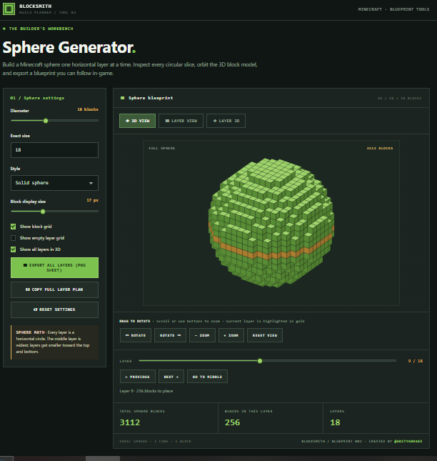
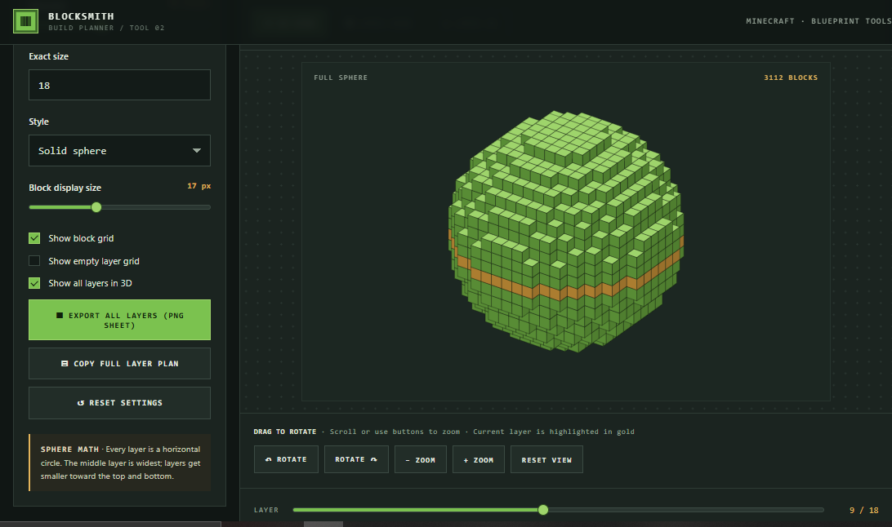
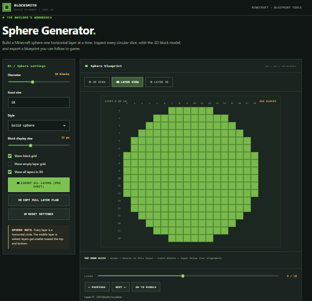
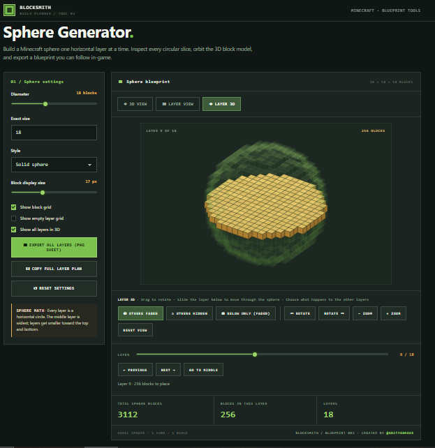

# Blocksmith — Minecraft Sphere Generator

Build a Minecraft sphere one horizontal layer at a time. Inspect every circular slice, orbit the 3D block model, and export a blueprint you can follow in-game.

**Live demo:** https://blocksmith-sphere-generator.vercel.app/



## Features

- **3D view** – drag to orbit, scroll to zoom. The current layer is highlighted in gold.
- **Layer view** – top-down slice of any layer, with a faint outline of the layer below to help you line blocks up.
- **Layer 3D view** – see only the selected layer in 3D. Other layers can be faded, hidden, or shown faded below only.
- **Layer slider** – step through layers with the slider, Previous / Next buttons, or the arrow keys.
- **Settings** – diameter from 3 to 41, solid sphere or hollow shell (adjustable thickness), block display size, grid toggles.
- **Export** – PNG sheet with one tile per layer, and a copyable text plan.

## Screenshots

| 3D view | Layer view | Layer 3D |
| --- | --- | --- |
|  |  |  |

## Usage

No build step and no dependencies. Open `index.html` in any modern browser, or use the live demo above.

To run it locally:

```bash
git clone https://github.com/YOUR-USERNAME/YOUR-REPO.git
cd YOUR-REPO
# then just open index.html in your browser
```

## How the sphere is built

Every layer is a horizontal circle. A block is placed when its centre is within half the diameter of the sphere's centre. The middle layer is the widest, and layers get smaller toward the top and bottom. For example, a 7-block sphere uses 179 blocks across layers of 9, 25, 37, 37, 37, 25 and 9.

## Hosting on GitHub Pages

1. Push `index.html` to your repo.
2. Go to **Settings → Pages**.
3. Set the source to your main branch (root folder) and save.

## Credit

Created by **[@adityabhaee](https://www.youtube.com/@adityabhaee)** on YouTube.

If you use, modify, share or showcase this tool (including in videos or streams), you must give visible credit to **@adityabhaee** and keep the credit link in the page footer.

## License

MIT License with the copyright notice below. The notice (and the credit in the page footer) must be kept in all copies and substantial portions of the project.

Copyright (c) 2026 @adityabhaee — https://www.youtube.com/@adityabhaee
